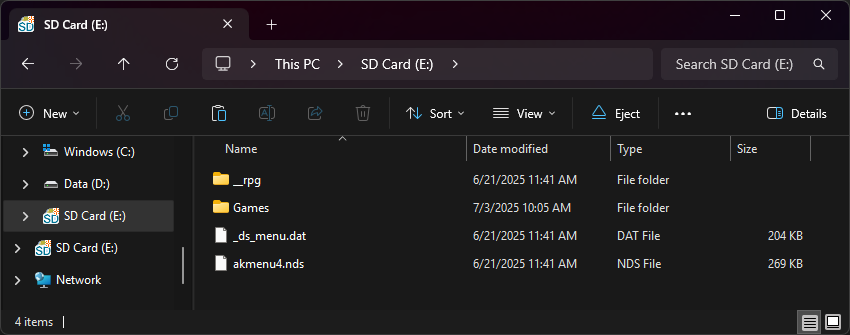
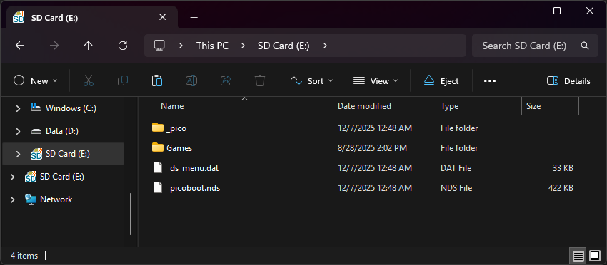

# BL2CK Carts
## Acekard/R4iTT Clones

!!! info "Compatibility Info"

    See [Flashcard-Archive Readme](https://github.com/DS-Homebrew/flashcard-archive) for a list of compatible carts.

!!! danger "Warning"

    Never attempt to use YSMenu on a cart that uses BL2CK! You will **brick** the cart!

### Setup Guide:

=== "Standard BL2CK"

    1. Format the SD card you are using by following the [formatting tutorial.](../tutorials/formatting.md){target="_blank"}

    1. Download the [BL2CK 1.31.0 kernel.](https://archive.flashcarts.net/BL2CK/BL2CK_1.31.0.zip)

    1. Open/extract the zip file, and copy *the contents* into the root of your SD card.

    1. If you'd like to be able to use cheats on your games, download a [cheat database.](https://gbatemp.net/threads/deadskullzjrs-nds-i-cheat-databases.488711)

    1. You will need the `usrcheat.dat` file from the download link in the post. Copy this file to `__rpg/cheats/` on your SD card. (Create the `cheats` folder if it doesn't exist)

    1. Create a `Games` folder in your SD card root, and place your `.nds` game ROMs inside. You can also create additional folders to help with organizing/categorizing your ROMs.

    1. The files on your SD card should now look like this:

        - { align=left width="600"}

    1. Insert the SD card back into your cart, plug the cart into your DS, and see if it boots into the menu.

    !!! tip "Themes"

        Looking to change the default theme? Check out the themes repository at [themes.flashcarts.net](https://themes.flashcarts.net)!

=== "Pico-Launcher"

    !!! note "Kernel Info"

        Pico-Launcher is the game menu for the DSpico (an open source DS flashcart by the LNH team) and other supported carts. Combined with Pico-Loader, it can be used as a full kernel, and supports almost all retail DS games. It features a material-inspired user interface, and an extremely fast loader.

    ??? warning "Soft-Reset Not Supported"

        Note that Pico-Launcher/Loader currently does not support soft-resetting to the game menu. If this is important to you, consider using BL2CK.

    1. Format the SD card you are using by following the [formatting tutorial.](../tutorials/formatting.md){target="_blank"}

    1. Download the latest [Pico Package for AK2.](https://mirrors.flashcarts.net/pico-builds/pico_package_AK2.zip)

    1. Extract the `pico_package_AK2.zip` file with [7-Zip](https://www.7-zip.org/), or your native file manager app.
        - <small>Currently updated to Pico-Launcher `{{pico_versions.launcher}}` and Pico-Loader `{{pico_versions.loader}}`</small>

    1. From within the extracted files, copy the following files/folders to your SD card root:

        - `_pico` folder

        - `_picoboot.nds`

        - `_ds_menu.dat`

    1. If you'd like to be able to use cheats on your games, download a [cheat database.](https://gbatemp.net/threads/deadskullzjrs-nds-i-cheat-databases.488711){target="_blank"}

    1. You will need the `usrcheat.dat` file from the download link in the post. Copy this file into the `_pico` folder on your SD card.

    1. Create a `Games` folder in your SD card root, and place any `.nds` game ROMs you'd like to play inside.

    1. The files on your SD card should now look like this:

        - { align=left width="600"}

    1. Insert the SD card back into your cart, plug the cart into your DS, and see if it boots into the menu.

    !!! tip "Post-Setup Enhancements"

        **Emulators**

        To emulate retro consoles like GBA, GB/C, NES, and others, you will need to add emulators and configure their file associations for Pico-Launcher to display retro ROMs in the menu.

        [Emulators Tutorial :octicons-arrow-right-16:](../tutorials/emulators-pico.md){ .md-button }

        **Game Covers**

        Pico-Launcher supports showing game covers in cover flow layout mode, and on the top screen in icons mode. You will need to add cover images to your SD card to use this feature.

        [PicoCover :octicons-arrow-right-16:](https://scaletta.github.io/PicoCover/){ .md-button }
        [TwilightBoxart :octicons-arrow-right-16:](https://twilightboxart.com/){ .md-button }
        [PicoDex :octicons-arrow-right-16:](https://rasalopa.github.io/picodex/){ .md-button }

        To create your own custom covers for Pico-Launcher, check out the cover creator. Save each cover in the `_pico/covers/user` folder on your SD card, named after its ROM file plus `.bmp` (for example, `MyGame.nds.bmp`).

        [Cover Creator :octicons-arrow-right-16:](https://tasken.github.io/banner-maker/#cover){ .md-button }

        **Themes**

        Looking to customize your DSpico interface? Check out the Pico themes repository:

        [Themes Repository :octicons-arrow-right-16:](https://themes.flashcarts.net/pico/){ .md-button }

        To create your own custom themes for Pico-Launcher, check out the themes creator:

        [Themes Creator :octicons-arrow-right-16:](https://santiagovalencia109.github.io/pl-Theme-Creator/){ .md-button }

=== "AKMenu-Next"

    !!! note "Kernel Info"

        AKMenu-Next is an alternative kernel based on akmenu4 (used in Wood R4 and AKAIO) and uses Pico-Loader (and optionally nds-bootstrap) to load games. This is an option if you prefer the Wood UI and it's themes over Pico-Launcher.

    ??? warning "Soft-Reset Not Supported for Pico-Loader"

        Note that Pico-Loader inside AKMenu-Next currently does not support soft-resetting to the game menu. If this is important to you, consider using BL2CK or using the nds-bootstrap loader within AKMenu-Next.

    1. Format the SD card you are using by following the [formatting tutorial.](../tutorials/formatting.md){target="_blank"}

    1. Download the latest [AKMenu-Next Flashcart Edition Package.](https://github.com/coderkei/akmenu-next/releases/latest/download/akmenu-next-flashcart.zip)

    1. Extract the downloaded `akmenu-next-flashcart.zip` file with [7-Zip](https://www.7-zip.org/).

    1. From within the akmenu-next files, copy the following files/folders to your SD card root:

        - `_nds` folder
        - `_pico` folder
        - `BOOT.NDS`

    1. Go into the `Autoboot` folder and then go into the `R4 Ultra & r4ids.cn` folder. Copy `_ds_menu.dat` to your SD card root.

    1. Download the latest release of [Pico-Loader for AK2](https://github.com/LNH-team/pico-loader/releases/latest/download/Pico_Loader_AK2.zip).

    1. Extract the downloaded `Pico_Loader_AK2.zip` file with [7-Zip](https://www.7-zip.org/).

    1. Copy the *contents* of the files from the extracted `Pico_Loader_AK2.zip` file to the `_pico` folder on your SD card.

    1. If you'd like to be able to use cheats on your games, download a [cheat database.](https://gbatemp.net/threads/deadskullzjrs-nds-i-cheat-databases.488711){target="_blank"}

    1. You will need the `usrcheat.dat` file from the download link in the post. Copy this file into the `_nds/akmenunext/cheats` folder on your SD card.

    1. Create a `Games` folder in your SD card root, and place any `.nds` game ROMs you'd like to play inside.

    1. Insert the SD card back into your cart, plug the cart into your DS, and see if it boots into the menu.

    1. Boot AKMenu-Next, press `START` and go to `Settings`. In the `Game loader settings` tab, change `Game Loader` to `Pico-Loader`, then press `A` and confirm to save.

    ??? info "nds-bootstrap installation (Optional)"

        1. Download the latest release of [nds-bootstrap](https://github.com/DS-Homebrew/nds-bootstrap/releases/latest/download/nds-bootstrap.zip).

        1. Extract the downloaded nds-bootstrap.zip file with [7-Zip](https://www.7-zip.org/).

        1. Copy the contents of the files from the extracted `nds-bootstrap.zip` file to the `_nds` folder on your SD card.

        1. In AKMenu-Next, press `Start` and go to `Settings`. Go to the `Game Loader` tab and change the `Game Loader` to `nds-bootstrap`.

    !!! tip "Post-Setup Enhancements"

        **Plugins**

        To emulate retro consoles like GBA, GB/C, NES, and others or to play media such as videos, you will need to add plugins to AKMenu-Next:

        [Plugins Tutorial :octicons-arrow-right-16:](https://coderkei.github.io/akmenu-next-docs/guides/plugins/#__tabbed_1_1){ .md-button }

        **Game Covers**

        AKMenu-Next can show game covers on the top screen. To use them, select one of the included cover themes: `Blue Skies Game Covers`, `DSpico Game Covers` or `Starlight Covers`. Then add cover images to your SD card. Covers made for Pico-Launcher work too.

        [PicoCover :octicons-arrow-right-16:](https://scaletta.github.io/PicoCover/){ .md-button }

        To create your own custom covers, check out the cover creator. Save each cover in the `_nds/covers_name` folder on your SD card, named after its ROM file without `.nds` (for example, `MyGame.bmp`).

        [Cover Creator :octicons-arrow-right-16:](https://tasken.github.io/banner-maker/#cover-akmenu){ .md-button }

        **Themes**

        Looking to customize your AKMenu-Next interface? Check out the AKMenu themes repository:

        [AKMenu-Next Themes Repository :octicons-arrow-right-16:](https://themes.flashcarts.net/aknext/){ .md-button }

        AKMenu-Next is also backwards compatible with Acekard/Wood R4 themes, you can find them here:

        [Acekard/Wood R4 Themes Repository :octicons-arrow-right-16:](https://themes.flashcarts.net/akmenu/){ .md-button }

=== "TWiLight Menu++"

    !!! note "Kernel Info"

        TWiLight Menu++ is an alternative kernel that can load DS games with Pico-Loader or nds-bootstrap. It features a Nintendo DSi style interface and it has rich customisation features. It does however take longer to start up compared to other menus such as AKMenu-Next or Pico-Launcher.

    ??? warning "Soft-Reset Not Supported for Pico-Loader"

        Note that Pico-Loader inside TWiLight Menu++ currently does not support soft-resetting to the game menu. If this is important to you, consider using BL2CK or using the nds-bootstrap loader within TWiLight Menu++.

    1. Download the latest release of [TWiLight Menu++ Flashcard Edition](https://github.com/DS-Homebrew/TWiLightMenu/releases/latest/download/TWiLightMenu-Flashcard.7z).

    1. Extract the downloaded `TWiLightMenu-Flashcard.7z` file with [7-Zip](https://www.7-zip.org/).

    1. From within the TWiLight files, copy the following files/folders to your SD card root:

        - `_nds` folder
        - `roms` folder
        - `BOOT.NDS`

    1. Open the `Autoboot` folder, then open the `R4 Ultra` folder and copy its contents to your SD card root.

    1. Download the latest release of [Pico-Loader for AK2](https://github.com/LNH-team/pico-loader/releases/latest/download/Pico_Loader_AK2.zip).

    1. Extract the downloaded `Pico_Loader_AK2.zip` file with [7-Zip](https://www.7-zip.org/).

    1. Create a folder on the SD card root called `_pico` if it does not already exist. Copy the `.bin` files from the extracted Pico-Loader files into the `_pico` folder on your SD card root.

    1. If you'd like to be able to use cheats on your games, download a [cheat database.](https://gbatemp.net/threads/deadskullzjrs-nds-i-cheat-databases.488711)

    1. You will need the `usrcheat.dat` file from the download link in the post. Copy this file to `_nds/TWiLightmenu/extras/` on your SD card.

    1. Place any `.nds` game ROMs you'd like to play into `/roms/nds` on your SD card.

    1. Insert the SD card back into your cart, plug the cart into your DS, and boot into TWiLight Menu++.

    1. Open TWiLight Menu++ DS Classic Menu by pressing `SELECT` and then pressing the settings icon on the bottom to enter TWiLight Menu++ settings, go to the `Games and Apps settings` page, and set `Game Loader` to `pico`.

    ??? info "nds-bootstrap (Alternative Game Loader)"

        If you would prefer to use nds-bootstrap, TWiLight Menu++ includes nds-bootstrap, so no additional files are needed to use it.

        1. Open TWiLight Menu++ DS Classic Menu by pressing `SELECT` and then pressing the settings icon on the bottom to enter TWiLight Menu++ settings.

        1. Set `Game Loader` to `nds-bootstrap` to use it for all games. You can also press `Y` on a selected game and change its `Game Loader` setting to use nds-bootstrap only for that game.

    !!! tip "Post-Setup Enhancements"

        **Plugins**

        While GBA game support is already included in TWiLight Menu++, To emulate retro consoles like GB/C, NES, and others or to play media such as videos, you will need to install addons to TWiLight Menu++:

        [Addons Tutorial :octicons-arrow-right-16:](https://wiki.ds-homebrew.com/twilightmenu/installing-addons?tab=manual){ .md-button }

        **Game Covers**

        TWiLight Menu++ supports showing game box art. DS-Homebrew details multiple options to download and install covers for your games.

        [TWiLight Menu++ box art :octicons-arrow-right-16:](https://wiki.ds-homebrew.com/twilightmenu/how-to-get-box-art){ .md-button }

        **Themes**

        Looking to customize your TWiLight Menu++ interface? Check out the DS-Homebrew themes repository:

        [Themes Repository :octicons-arrow-right-16:](https://skins.ds-homebrew.com/){ .md-button }

        [Theme installation instructions :octicons-arrow-right-16:](https://wiki.ds-homebrew.com/twilightmenu/faq?faq=how-do-i-install-custom-themes-for-twilight-menu){ .md-button }

=== "Amaze3DS BL2CK"

    1. Format the SD card you are using by following the [formatting tutorial.](../tutorials/formatting.md){target="_blank"}

    1. Download the [BL2CK 1.31.0 Amaze3DS kernel.](https://archive.flashcarts.net/BL2CK/BL2CK_1.31.0_Amaze3DS.zip)

    1. Open/extract the zip file, and copy *the contents* into the root of your SD card.

    1. If you'd like to be able to use cheats on your games, download a [cheat database.](https://gbatemp.net/threads/deadskullzjrs-nds-i-cheat-databases.488711)

    1. You will need the `usrcheat.dat` file from the download link in the post. Copy this file to `__rpg/cheats/` on your SD card. (Create the `cheats` folder if it doesn't exist)

    1. Create a `Games` folder in your SD card root, and place your `.nds` game ROMs inside. You can also create additional folders to help with organizing/categorizing your ROMs.

    1. The files on your SD card should now look like this:

        - { align=left width="600"}

    1. Insert the SD card back into your cart, plug the cart into your DS, and see if it boots into the menu.

    !!! tip "Post-Setup Enhancements"

        **Emulators**

        To emulate retro consoles on your DS like GBA, GB/C, NES, and others, you will need to download emulators.

        [Emulators Tutorial :octicons-arrow-right-16:](../tutorials/emulators.md){ .md-button }

        **Themes**

        Looking to customize your menu? Check out the AKMenu themes repository:

        [Themes Repository :octicons-arrow-right-16:](https://themes.flashcarts.net/akmenu/){ .md-button }
