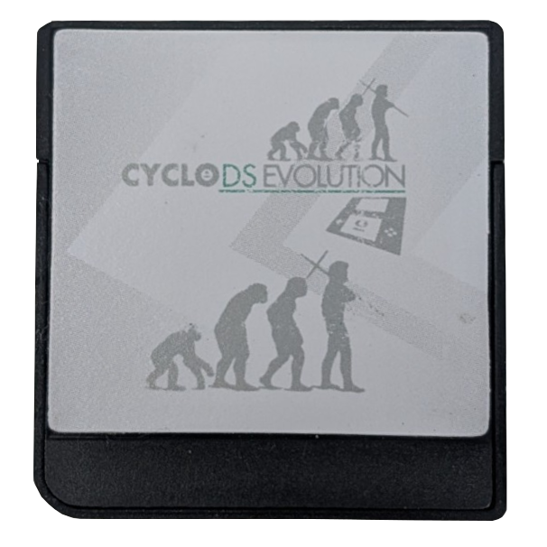
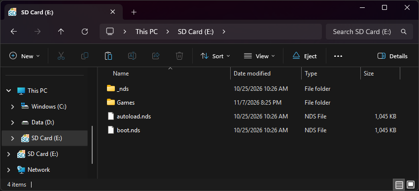
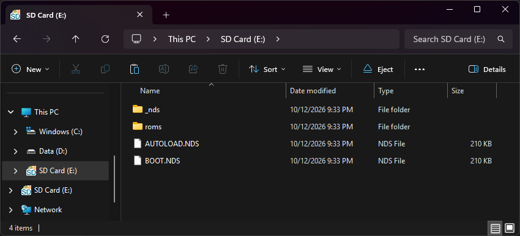
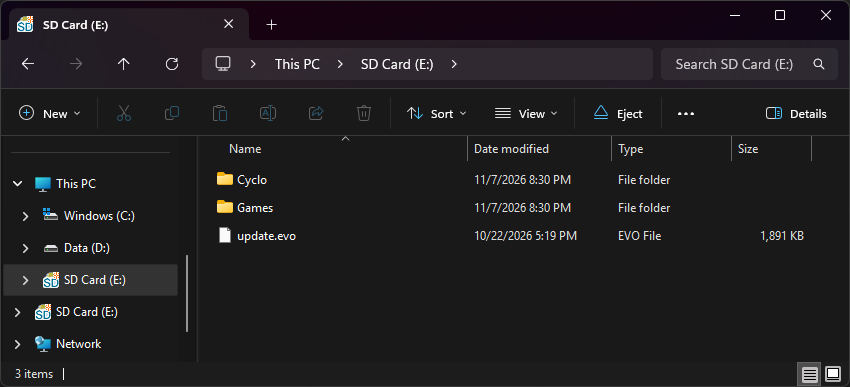

{ align=right width="115"}
# CycloDS Evolution
## cyclopsds.com

!!! info "Cart Info"

    This cart is an original hardware family, shared by the EDGE cart. It has some unique features, such as onboard storage for the kernel so that it doesn't need to be loaded off the SD card, and it also supports RTS. The DSi version of this cart, the CycloDS iEvolution, is the first DSi-mode cart made. Unfortunately, this entire cart family is fairly obscure hardware, so not many loader options currently exist. The stock kernel and nds-bootstrap + AKNext/TWiLight are the only currently usable options.

!!! note "Kernel Info"

    Although the stock kernel may contain some extra features like RTS, it is outdated and unable to load some newer DS games. Therefore, AKMenu-Next or TWiLight Menu++ are the recommended options for this cart. However, a setup guide for the stock kernel is also provided below if you would like to use it instead.

### Setup Guide:

=== "AKMenu-Next"

    1. Format the SD card you are using by following the [formatting tutorial.](../tutorials/formatting.md){target="_blank"}

    1. Download the latest release of [AKMenu-Next Flashcart Edition.](https://github.com/coderkei/akmenu-next/releases/latest/download/akmenu-next-flashcart.zip)

    1. Extract the downloaded `akmenu-next-flashcart.zip` file with [7-Zip](https://www.7-zip.org/){target="_blank"}.

    1. From within the AKMenu-Next files, copy the following files/folders to your SD card root:

        - `_nds` folder
        - `boot.nds`
    
    1. Make a copy of `boot.nds` and rename it to `autoload.nds`.
        - This will make the cart autoboot AKMenu-Next. Remember to update this file when updating AKNext in the future.

    1. Download the latest release of [nds-bootstrap.](https://github.com/DS-Homebrew/nds-bootstrap/releases/latest/download/nds-bootstrap.zip)

    1. Extract `nds-bootstrap.zip`, and copy *the contents* into the `_nds` folder on your SD card.

    1. If you'd like to be able to use cheats on your games, download a [cheat database.](https://gbatemp.net/threads/deadskullzjrs-nds-i-cheat-databases.488711){target="_blank"}
    
    1. Download the `usrcheat.dat` file from the download link in the post. Copy this file to `_nds/akmenunext/cheats/` on your SD card.
        
    1. Next, create a `Games` folder on your SD card root, and place your `.nds` game ROMs inside.
        - You can also create additional folders to help with organizing/categorizing your ROMs.
    
    1. The files on your SD card should now look like this:
    
         - { align=left width="600"}

    1. Insert the SD card back into your cart, plug the cart into your DS, and see if it boots into the menu.
    
    !!! tip "Post-Setup Enhancements"

        AKMenu-Next supports emulator plugins for playing GBA, GB/C, NES, and other retro consoles. See the AKNext docs for setup:

        [AKMenu-Next Plugins :octicons-arrow-right-16:](https://coderkei.github.io/akmenu-next-docs/guides/plugins/){ .md-button }
        
        **Game Covers**

        AKMenu-Next can show game covers on the top screen. To use them, select one of the included cover themes: `Starlight Covers`, `Blue Skies Game Covers`, or `DSpico Game Covers`. Then add cover images to your SD card. Covers made for Pico-Launcher work too.

        [PicoCover :octicons-arrow-right-16:](https://scaletta.github.io/PicoCover/){ .md-button }

        To create your own custom covers, check out the cover creator. Save each cover in the `_nds/covers_name` folder on your SD card, named after its ROM file without `.nds` (for example, `MyGame.bmp`).

        [Cover Creator :octicons-arrow-right-16:](https://tasken.github.io/banner-maker/#cover-akmenu){ .md-button }

        **Themes**
        
        Looking to customize your AKMenu-Next interface? Check out the AKMenu and AKNext themes repositories:
        
        [AKMenu Themes :octicons-arrow-right-16:](https://themes.flashcarts.net/akmenu/){ .md-button }
        [AKMenu-Next Themes :octicons-arrow-right-16:](https://themes.flashcarts.net/aknext/){ .md-button }

=== "TWiLight Menu++"

    1. Format the SD card you are using by following the [formatting tutorial.](../tutorials/formatting.md){target="_blank"}

    1. Download the latest release of [TWiLight Menu++ Flashcart Edition.](https://github.com/DS-Homebrew/TWiLightMenu/releases/latest/download/TWiLightMenu-Flashcard.7z)

    1. Extract the downloaded `TWiLightMenu-Flashcard.7z` file with [7-Zip](https://www.7-zip.org/){target="_blank"}.

    1. From within the extracted TWiLight Menu++ files, copy the following files/folders to your SD card root:

        - `_nds` folder
        - `roms` folder
        - `BOOT.NDS`
    
    1. Make a copy of `BOOT.NDS` and rename it to `AUTOLOAD.NDS`.

    1. The files on your SD card should now look like this:
    
         - { align=left width="600"}
    
    1. Insert the SD card back into your cart, plug the cart into your DS, and see if it boots into TWiLight Menu++.

    !!! tip "Post-Setup Enhancements"

        **Plugins**

        While GBA game support is already included in TWiLight Menu++, to emulate retro consoles like GB/C, NES, and others or to play media such as videos, you will need to install addons to TWiLight Menu++:

        [Addons Tutorial :octicons-arrow-right-16:](https://wiki.ds-homebrew.com/twilightmenu/installing-addons?tab=manual){ .md-button }

        **Game Covers**

        TWiLight Menu++ supports showing game box art. DS-Homebrew details multiple options to download and install covers for your games.

        [TWiLight Menu++ Box Art :octicons-arrow-right-16:](https://wiki.ds-homebrew.com/twilightmenu/how-to-get-box-art){ .md-button }

        **Themes**

        Looking to customize your TWiLight Menu++ interface? Check out the DS-Homebrew themes repository:

        [Themes Repository :octicons-arrow-right-16:](https://skins.ds-homebrew.com/){ .md-button }

        [Theme Installation Instructions :octicons-arrow-right-16:](https://wiki.ds-homebrew.com/twilightmenu/faq?faq=how-do-i-install-custom-themes-for-twilight-menu){ .md-button }

=== "CycloDS 2.3 Kernel"

    1. Format the SD card you are using by following the [formatting tutorial.](../tutorials/formatting.md){target="_blank"}

    1. Download the [CycloDS Evolution 2.3 kernel.](https://archive.flashcarts.net/CycloDS/CycloDS_Evolution/CycloDS_Evolution_2.3.zip)

    1. Open/extract the zip file, and copy `update.evo` into the root of your SD card.

    1. If you'd like to be able to use cheats on your games, you will need a [cheat database.](https://gbatemp.net/threads/deadskullzjrs-nds-i-cheat-databases.488711)
        
    1. Download the `user.evoCheats` file from the download link in the post.
    
    1. On your SD card root, create a `Cyclo` folder, then place `user.evoCheats` inside it.

    1. Create a `Games` folder in your SD card root, and place your `.nds` game ROMs inside.
        - You can also create additional folders to help with organizing/categorizing your ROMs.
    
    1. The files on your SD card should now look like this:
    
         - { align=left width="600"}

    1. Insert the SD card back into your cart, plug the cart into your DS, and see if it boots into the menu.
    
    !!! tip "Post-Setup Enhancements"

        **Emulators**
        
        To emulate retro consoles on your DS like GBA, GB/C, NES, and others, you will need to download emulators.
        
        [Emulators Tutorial :octicons-arrow-right-16:](../tutorials/emulators.md){ .md-button }